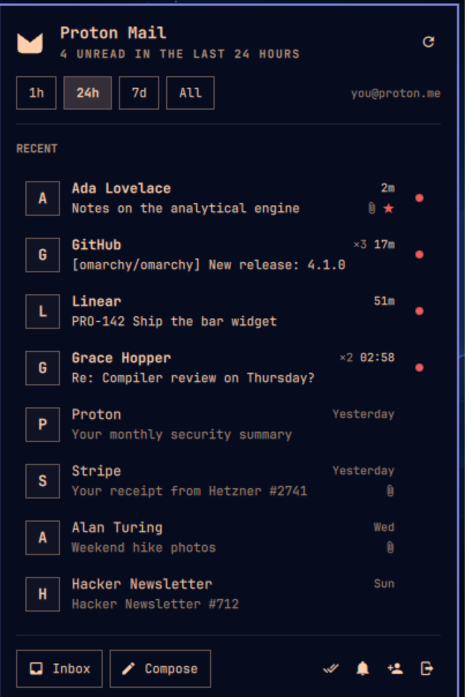

# Promarchy

Proton Mail in the [Omarchy](https://omarchy.org) bar: an unread count for the last hour, day or week, a dropdown of recent mail, and native desktop notifications.

<p>
  <br>
  
</p>

*(Screenshots use the built-in demo mode, not a real inbox.)*

## Features

- **Bar badge.** A Proton-style envelope with the number of unread inbox messages received in the **last hour, 24 hours or 7 days**, or all unread, or no number at all. Switch windows right in the dropdown (or press <kbd>1</kbd>–<kbd>4</kbd>), and the choice is saved to your bar settings.
- **Recent mail dropdown.** Sender, subject and time; unread dots; sender logos; attachment and star markers; each conversation is one row with its exact message count (`×3`). Click a message to open it in Proton Mail; hover and click ✓ (or press <kbd>m</kbd>) to mark it read.
- **Notifications.** New mail shows up as a regular Omarchy toast (theme, Do Not Disturb and history included). Clicking it opens the message. A burst of mail collapses into one summary, and after a long sleep you only catch up on the last hour.
- **Inbox categories.** Count only *Primary*, or any mix of Proton's categories.
- **Multiple accounts.** Sign in to more than one; counts and lists merge, and if one account stops working the dropdown says so instead of quietly showing partial totals. Clicking a message opens Proton Mail in whichever account is active in your browser, so with several accounts switch to the right one there first (Proton's web links cannot pick the account).
- **Keyboard driven.** Like Omarchy's own panels: arrows or <kbd>j</kbd>/<kbd>k</kbd>, <kbd>Enter</kbd> to open, <kbd>←</kbd>/<kbd>→</kbd> to switch window, <kbd>m</kbd>/<kbd>x</kbd> mark read, <kbd>a</kbd> mark all shown read, <kbd>r</kbd> refresh, <kbd>o</kbd> inbox, <kbd>c</kbd> compose, <kbd>n</kbd> toggle notifications, <kbd>Esc</kbd> close, <kbd>Tab</kbd> next panel.
- **Light on resources.** About 30 MB of memory and a few milliseconds of CPU a minute. While idle it makes one small request per poll to Proton's event stream, and only re-reads mail when something changed. Window counts age out locally, so "last hour" stays current without extra requests (exact up to 750 unread messages in a week; beyond that the dropdown shows `750+`).

## How it works

```
 bar widget (QML, one per monitor)          promarchyctl daemon (Python, one per session)
 ┌───────────────────────────────┐  stdin   ┌──────────────────────────────────────────┐
 │ BarWidget.qml  ── Service.qml ├─────────►│ configure / refresh / poll / markRead     │
 │   badge, dropdown             │◄─────────┤ JSON state lines (counts, recent mail)    │
 └───────────────────────────────┘  stdout  │                                          │
                                            │  GET /core/v4/events/<cursor>  every 30s  │──► Proton API
                                            │  re-query only when the inbox changed     │   (metadata only)
                                            │  session tokens ◄──► GNOME Keyring        │
                                            └──────────────────────────────────────────┘
```

The daemon signs in with its own Proton session, so there is no browser window to keep open and no scraping. It reads message **metadata** (sender, subject, time, flags), which Proton stores unencrypted. It never requests message bodies and contains no code to unlock keys or decrypt mail.

## Install

Promarchy needs Proton's own SRP library for signing in (from Arch's official repos) and `secret-tool`, which Omarchy already ships:

```bash
omarchy pkg add python-proton-core libsecret
```

Then add the plugin. It lands in the right side of the bar:

```bash
omarchy plugin add https://github.com/atlastimed/promarchy.git --enable
```

Click the envelope and choose **Sign in**. A small terminal asks for your Proton username, password and 2FA code. Proton usually asks new apps for a quick **CAPTCHA**. It opens in your browser; solve it, come back to the terminal and press Enter (this is the same flow Proton Bridge uses).

## Settings

Change settings from Omarchy's settings panel, from the dropdown, or with `omarchy bar set`:

```bash
omarchy bar set atlastimed.promarchy countWindow 7d
omarchy bar set atlastimed.promarchy categories primary
omarchy bar set atlastimed.promarchy notify false
```

| Setting | Default | What it does |
|---|---|---|
| `countWindow` | `24h` | Badge counts unread mail from `1h`, `24h`, `7d`, `all`, or `off` (no number). |
| `recentCount` | `8` | Messages in the dropdown (0–25). |
| `pollSeconds` | `30` | How often to check Proton's event stream (10–900). |
| `notify` | `true` | Desktop notifications for new mail. |
| `categories` | `all` | `all`, or a comma list of `primary`, `social`, `promotions`, `updates`, `forums`, `newsletters`, `transactions`. Applies to the badge, list and notifications. |
| `groupThreads` | `true` | Collapse a busy conversation into one row with a count. |
| `senderImages` | `true` | Sender logos, fetched through Proton's own logo proxy (as the web app does) and cached. |
| `openWith` | `browser` | Open mail in your default `browser`, or as a standalone `webapp` window. |

**Mouse:** left click opens the dropdown, right click opens your inbox (an existing Proton window is focused rather than duplicated), and middle click refreshes.

**Keyboard shortcut:** to toggle the dropdown with <kbd>Super</kbd>+<kbd>Ctrl</kbd>+<kbd>M</kbd>, the same pattern as Omarchy's own panels, add this to `~/.config/hypr/bindings.lua`:

```lua
o.bind("SUPER + CTRL + M", "Proton Mail", "omarchy-shell shell toggle atlastimed.promarchy")
```

## Command line

The backend doubles as a small CLI (`~/.config/omarchy/plugins/atlastimed.promarchy/backend/promarchyctl`):

| Command | |
|---|---|
| `promarchyctl login [user]` | Sign in (another account if you already have one). |
| `promarchyctl logout [email\|--all] [--local]` | End the session on Proton's side, then forget it here (`--local`: forget it even if Proton is unreachable). |
| `promarchyctl accounts` | List signed-in accounts. |
| `promarchyctl status [--json] [--window 24h]` | Print the bar's current counts, for scripts. |
| `promarchyctl notify-test` | Show what a new-mail notification looks like. |

## Privacy and security

What Promarchy does, stated precisely:

- **Password.** Used once, in memory, for Proton's [SRP](https://proton.me/blog/encrypted-email-authentication) handshake, then discarded; it is never sent, written to disk or logged. (In Proton's default one-password mode that password also protects your mailbox keys, so treat the sign-in prompt with the same care as Proton's own.) The SRP maths is Proton's own code (`python-proton-core`), and the server's modulus is only used after its signature checks out against Proton's pinned key.
- **No mail bodies, no decryption.** Promarchy requests message metadata only and has no code to unlock keys or decrypt mail. If you sign in with a bare username rather than a full address, it reads your address list to name the account; Proton includes your password-encrypted private keys in that response, and Promarchy ignores and never stores them.
- **Session tokens** live in GNOME Keyring (passed to `secret-tool` on stdin, never as arguments). They are never logged: diagnostics record only an error's type and code location, and stored tokens are shape-checked so a corrupted value cannot end up quoted in an error.
- **One exception, for the CAPTCHA.** When Proton asks for a human check, its short-lived verification link (which contains a one-time token for that sign-in attempt) is handed to your browser as a launch argument. It is not printed or logged by Promarchy, but your browser's history keeps it like any other visited page. It grants nothing without your password.
- **What is stored outside the keyring**, all `0600` in `0700` directories:

  | Where | What |
  |---|---|
  | `~/.local/state/promarchy/accounts.json` | signed-in addresses |
  | `~/.local/state/promarchy/notified.json` | per-account notification progress (times and recent message IDs) |
  | `~/.local/state/promarchy/last-login.json` | time and outcome of the last sign-in |
  | `$XDG_RUNTIME_DIR/promarchy/state.json` | the bar's current snapshot: senders, subjects, times, counts (in memory-backed storage, gone at logout/reboot) |
  | `~/.cache/promarchy/logos/` | sender logos, named by a hash of the address, expired after 14 days |

  Omarchy's notification history also keeps the sender and subject of announced mail.
- **Sender logos** are fetched from Proton's logo proxy, so Proton (not a third party) sees which sender address is looked up. SVG logos that reference external resources or contain scripts are discarded.
- **Signing out** ends the session on Proton's side first and only then forgets it here. If Proton cannot be reached, you are told and stay signed in (`promarchyctl logout --local` forgets it anyway; end it later under Proton's *Settings → Security → Session management*). Removing the plugin does not sign you out: run `promarchyctl logout --all` first.
- **Writes to your mailbox:** only *mark as read*, and only when you ask.
- Proton does not publish a third-party API. Promarchy uses the same endpoints as the Proton web app, identifies itself honestly (`x-pm-appversion: Other`, `User-Agent: Promarchy/…`), and keeps its traffic small.

## Troubleshooting

- **The widget did not change after an update.** The shell sometimes keeps the old QML cached. Run `omarchy restart shell`.
- **"Proton's human verification was not completed".** Run the sign-in again and finish the CAPTCHA in the browser *before* pressing Enter in the terminal.
- **Security keys.** If your only second factor is a FIDO2 security key, sign-in cannot finish: Promarchy supports authenticator-app (TOTP) codes. Add an authenticator app as a second method in Proton's settings.
- **Logs.** `qs log -p /usr/share/omarchy/shell | grep promarchy`

## Compatibility

Built and tested on Omarchy 4.0 (Arch Linux) with Quickshell 0.3.1, Qt 6.11, Python 3.14 and python-proton-core 0.7.4, on a horizontal top bar across three monitors. CI checks the plugin contract, QML syntax and the backend and widget-model tests on Arch Linux; it does not drive a live Omarchy desktop. Other bar positions follow Omarchy's own layout code but have had less real-world use. `HTTPS_PROXY` is honoured with a plain `CONNECT` tunnel; authenticated and SOCKS proxies are not supported.

## Uninstall

```bash
~/.config/omarchy/plugins/atlastimed.promarchy/backend/promarchyctl logout --all
omarchy plugin remove atlastimed.promarchy
rm -rf ~/.local/state/promarchy ~/.cache/promarchy
```

## Development

```bash
uv venv --system-site-packages .venv && uv pip install --python .venv/bin/python pytest ruff
.venv/bin/pytest -q            # backend tests (fake Proton API, no network)
node --test tests/             # widget model tests
scripts/check-plugin.sh        # Omarchy plugin contract + QML syntax
```

`omarchy bar set atlastimed.promarchy demo true` swaps in sample data (no account or network), handy for screenshots and UI work. CI runs all of the above on Arch Linux.

## License

[MIT](LICENSE)
